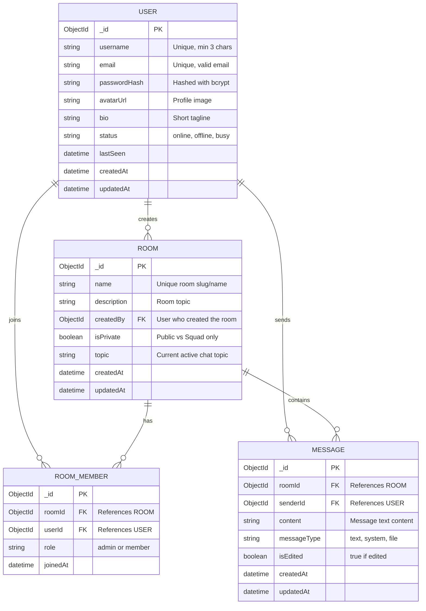

# Yapster - Database Schema (Data Model) 🗄️

## 1. Schema Overview (Entity-Relationship Diagram)

---

## 2. Model Specifications (MongoDB / Mongoose or PostgreSQL)

### A. User Collection (`users`)
- `_id`: ObjectId (Primary Key)
- `username`: String (Indexed, Unique, Required, Lowercase)
- `email`: String (Indexed, Unique, Required)
- `password`: String (Hashed with bcrypt, min 60 chars)
- `avatar`: String (Default avatar URL)
- `status`: String (Default: "offline", Enum: `['online', 'offline', 'yapping']`)
- `createdAt` & `updatedAt`: Timestamps

### B. Room / Channel Collection (`rooms`)
- `_id`: ObjectId (Primary Key)
- `name`: String (Unique, Required, e.g. "general", "dev-talk", "memes")
- `description`: String (Max 200 chars)
- `createdBy`: ObjectId (Ref to `users`, Required)
- `isPrivate`: Boolean (Default: false)
- `memberCount`: Number (Default: 1)
- `createdAt` & `updatedAt`: Timestamps

### C. Message Collection (`messages`)
- `_id`: ObjectId (Primary Key)
- `roomId`: ObjectId (Ref to `rooms`, Indexed for fast retrieval)
- `senderId`: ObjectId (Ref to `users`, Required)
- `content`: String (Required, 1 - 2000 chars)
- `createdAt`: Date (Indexed for chronological sorting / pagination)
- `updatedAt`: Date

### D. RoomMember Collection (`room_members`)
- `_id`: ObjectId (Primary Key)
- `roomId`: ObjectId (Ref to `rooms`, Compound index with userId)
- `userId`: ObjectId (Ref to `users`)
- `role`: String (Enum: `['admin', 'member']`, Default: "member")
- `joinedAt`: Date (Default: Date.now)
